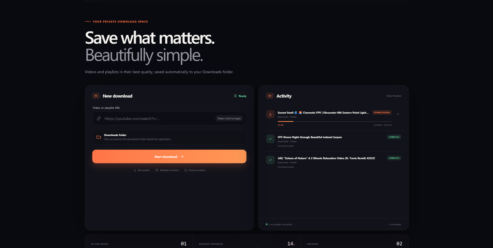
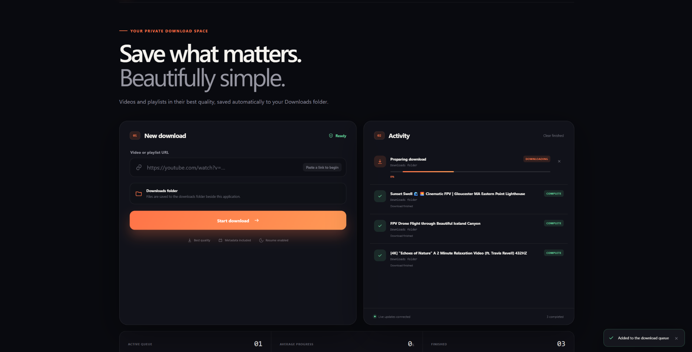
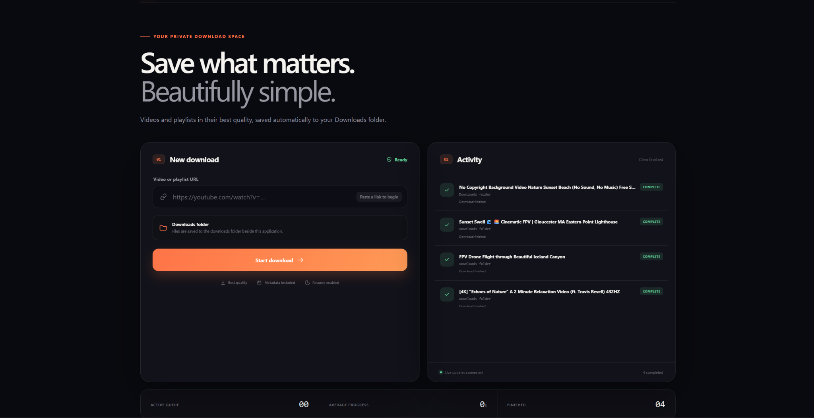
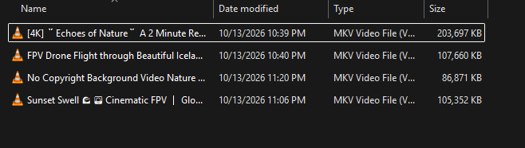

# Download Studio

**Local-first video download manager built with Spring Boot, Angular, yt-dlp, FFmpeg and Docker.**

Download Studio turns a command-line media workflow into a polished local application with a download queue, live progress, persistent history, cancel/retry controls and portable Docker packaging.

> Download Studio is intended for media you own, have permission to download, or that is otherwise legally available for download. Users are responsible for complying with applicable platform terms and copyright law.



## What this project demonstrates

- Java 17 + Spring Boot 4.1
- Angular frontend
- REST API for download lifecycle management
- Server-Sent Events (SSE) for live job updates
- `yt-dlp` process orchestration
- FFmpeg media processing
- download queue with progress, speed and ETA
- cancel and retry operations
- persistent download history
- browser notifications on completion/failure
- dark/light theme support
- Docker multi-stage build
- loopback-only container exposure by default
- non-root container runtime
- read-only container filesystem
- dropped Linux capabilities and `no-new-privileges`
- bind-mounted download output
- portable Docker image export with SHA-256 verification

## Product walkthrough

### Live download queue

Submitting a URL creates a download job in Spring Boot. The Angular UI receives real-time updates over SSE and displays progress, speed, ETA and job status.


### Queue and persistent history

Completed jobs remain visible alongside active work, while new jobs are added to the same activity view.



### Completed downloads

The finished state provides a clean history of completed jobs while the live SSE connection remains active.



### Files written to the host

In Docker mode, completed media is written through the `/downloads` bind mount to the host-side `downloads/` directory.



## How it works

```text
Browser / Angular
       |
       | REST
       v
Spring Boot API
       |
       | create / cancel / retry
       v
Download service
       |
       | launches
       v
download_single.sh
       |
       +--> yt-dlp
       |
       +--> FFmpeg
       |
       v
/downloads
       |
       +--------------------+
       |                    |
       | SSE job updates    | persisted history
       v                    v
Angular activity UI     history.json
```

The frontend uses REST for commands and a long-lived Server-Sent Events connection for job updates.

Typical lifecycle:

```text
URL submitted
    ↓
QUEUED
    ↓
DOWNLOADING
    ↓
PROCESSING
    ↓
COMPLETED
```

Jobs can also transition to `FAILED` or `CANCELED`. Failed/canceled jobs can be retried from the UI.

## Stack

| Layer | Technology |
| --- | --- |
| Backend | Java 17, Spring Boot 4.1 |
| Frontend | Angular |
| Live updates | Server-Sent Events |
| Download engine | yt-dlp |
| Media processing | FFmpeg |
| Packaging | Docker / Docker Compose |
| Build | Maven, npm |
| Persistence | JSON download history + host download directory |

## Quick start with Docker

For normal use, Docker with the Compose plugin is the only host requirement.

```bash
docker compose up --build -d
```

Open:

```text
http://127.0.0.1:8080
```

Downloads are saved automatically in:

```text
./downloads/
```

Stop the application with:

```bash
docker compose down
```

Check status or logs with:

```bash
docker compose ps
docker compose logs --tail=100 app
```

## Docker design

The production image uses a multi-stage build:

```text
Node 24
  ↓
Angular production build

Maven + Java 17
  ↓
Spring Boot JAR

Runtime image
  ├── Java 17 JRE
  ├── yt-dlp
  ├── FFmpeg
  ├── Python 3
  ├── tini
  └── packaged application
```

The default Compose configuration deliberately keeps the application local:

```yaml
ports:
  - "127.0.0.1:8080:8080"
```

Additional runtime hardening includes:

- application runs as an unprivileged user
- container root filesystem is read-only
- all Linux capabilities are dropped
- `no-new-privileges` is enabled
- temporary writable space is provided through `tmpfs`
- downloads are written through a dedicated bind mount
- history is stored in a dedicated Docker volume

The application UI does not expose a general-purpose server filesystem browser.

## API

Download lifecycle:

```text
GET    /api/downloads
GET    /api/downloads/{id}
POST   /api/downloads
POST   /api/downloads/{id}/cancel
POST   /api/downloads/{id}/retry
DELETE /api/downloads/finished
GET    /api/downloads/events
```

System readiness:

```text
GET /api/system/status
```

The status endpoint verifies the availability of `yt-dlp`, `ffmpeg` and the configured download script.

## Development

Source development requires:

- Java 17+
- Node.js 24+
- `yt-dlp`
- FFmpeg

Run the Spring Boot backend:

```bash
./mvnw spring-boot:run
```

On Windows:

```cmd
mvnw.cmd spring-boot:run
```

Then start Angular from another terminal:

```bash
cd frontend
npm install
npm start
```

Open:

```text
http://127.0.0.1:4200
```

The Angular development server proxies API requests to Spring Boot.

## Build after code changes

Build Angular first:

```bash
cd frontend
npm ci
npm run build
cd ..
```

Then package Spring Boot:

```bash
./mvnw clean package
```

The executable JAR is created at:

```text
target/download-studio-1.0.0.jar
```

Run it from the project root:

```bash
java -jar target/download-studio-1.0.0.jar
```

## Configuration

Supported environment variables include:

| Variable | Purpose |
| --- | --- |
| `PORT` | Spring Boot port |
| `DOWNLOAD_SCRIPT` | downloader script path |
| `DOWNLOAD_HISTORY` | history JSON location |
| `DOWNLOAD_DIRECTORY` | native application output directory |
| `DOWNLOAD_DIR` | host directory mapped into Docker |
| `DOWNLOAD_STUDIO_PORT` | host port used by Docker Compose |

For Docker, copy the example environment file if you want a custom download directory:

```bash
cp .env.example .env
```

Example:

```dotenv
DOWNLOAD_DIR=/absolute/path/to/videos
DOWNLOAD_STUDIO_PORT=8080
```

## Portable Docker bundle

The project can export a self-contained Docker image bundle for another computer:

```bash
./export-image.sh
```

The generated bundle under `artifacts/portable/` contains:

```text
download-studio-1.0.0.tar
download-studio-1.0.0.tar.sha256
docker-compose.yml
```

On the destination machine:

```bash
sha256sum --check download-studio-1.0.0.tar.sha256
docker load --input download-studio-1.0.0.tar
docker compose up -d
```

The destination computer needs Docker with Compose, but does not need the source code, Java, Node.js, `yt-dlp` or FFmpeg installed separately.

> The exported image targets the CPU architecture of the machine that builds it. Rebuild the image when moving between incompatible architectures such as `amd64` and ARM.

## Repository layout

```text
.
├── frontend/                    # Angular application
├── src/                         # Spring Boot backend
├── docs/                        # diagrams and technical guides
├── artifacts/portable/          # generated portable image bundle
├── downloads/                   # host-side download output
├── download_single.sh           # yt-dlp / FFmpeg orchestration
├── docker-compose.yml
├── docker-compose.portable.yml
├── Dockerfile
├── export-image.sh
├── pom.xml
└── README.md
```

## Documentation

Additional technical material is available under [`docs/`](docs/):

- class diagram and Mermaid source
- Docker usage guide
- detailed Docker technical guide
- PDF technical handbook

## Engineering decisions worth discussing

**Why SSE instead of WebSocket?**  
The browser primarily needs one-way server-to-client progress events. SSE keeps the real-time channel simple and works over normal HTTP.

**Why wrap yt-dlp instead of reimplementing downloading logic?**  
The project focuses on application orchestration, job lifecycle, UI state and packaging while delegating media extraction to a mature specialized tool.

**Why bind to `127.0.0.1` by default?**  
This is designed as a local application. Loopback-only publishing avoids exposing the service to the local network unless the operator deliberately changes the configuration.

**Why use a host bind mount for downloads?**  
Completed files should survive container recreation and remain immediately accessible from the host.

**Why persist history separately from downloaded media?**  
Job metadata and media files have different lifecycle requirements. A Docker volume stores history while the bind mount exposes completed media directly to the user.

## License

No license has been added yet.
