# Download Studio Class Diagram

This class diagram represents the current Angular frontend, Spring Boot API and download domain, persistence layer, and external downloader runtime.



## Available formats

- [`CLASS_DIAGRAM.mmd`](./CLASS_DIAGRAM.mmd) — editable Mermaid source.
- [`CLASS_DIAGRAM.svg`](./CLASS_DIAGRAM.svg) — scalable vector diagram; best for zooming, documentation, and printing.
- [`CLASS_DIAGRAM.png`](./CLASS_DIAGRAM.png) — high-resolution raster diagram; convenient for presentations and sharing.

## How to read the relationships

| UML notation | Meaning in this diagram |
| --- | --- |
| `A --> B` | `A` directly uses or delegates to `B`. |
| `A ..> B` | `A` temporarily depends on, accepts, returns, or communicates with `B`. |
| `A o-- B` | `A` aggregates and retains one or more `B` objects. |
| `A *-- B` | `B` is owned or defined as part of `A`. |
| `A ..|> B` | `A` implements the `B` interface. |
| `0..*`, `0..50` | Relationship multiplicity. |

## Layer summary

### Angular frontend

- `AppComponent` manages the form, directory picker, activity display, theme, toast messages, and user actions.
- Angular `DownloadService` owns reactive job/system state, calls REST endpoints, opens the SSE connection, and creates browser notifications.
- TypeScript interfaces describe the JSON data returned by Spring Boot.

### Spring API

- `DownloadController` exposes download lifecycle operations and the SSE endpoint.
- `DirectoryController` provides server-side folder browsing and creation.
- `SystemController` reports downloader readiness and the default directory.
- `ApiExceptionHandler` converts API failures into consistent responses and handles normal SSE disconnections.
- `SpaController` forwards frontend routes to Angular, while `WebConfig` configures development CORS.

### Spring download domain

- `DownloadService` validates requests, manages the single-thread queue, controls operating-system processes, parses progress, and coordinates events/history.
- `DownloadJob` is the mutable internal domain entity.
- `DownloadSnapshot` is the immutable representation returned to the API, sent through SSE, and stored in history.
- `DownloadEventHub` retains active `SseEmitter` clients and publishes updates.
- `HistoryStore` serializes the latest snapshots to `/data/history.json`.

### External runtime

- Spring starts `download_single.sh` through `ProcessBuilder`.
- The script invokes `yt-dlp`, which uses FFmpeg when media streams require merging or metadata processing.
- Final media is written under the bind-mounted `/downloads` directory.

## Regenerate the diagram

With Mermaid CLI available:

```bash
cd /home/houssamed/Documents/UsefulScripts
npx --yes @mermaid-js/mermaid-cli \
  -i download-studio/docs/CLASS_DIAGRAM.mmd \
  -o download-studio/docs/CLASS_DIAGRAM.svg \
  -b transparent
```

The `.mmd` source is the canonical editable version. Regenerate the SVG and PNG after changing project classes or relationships.

